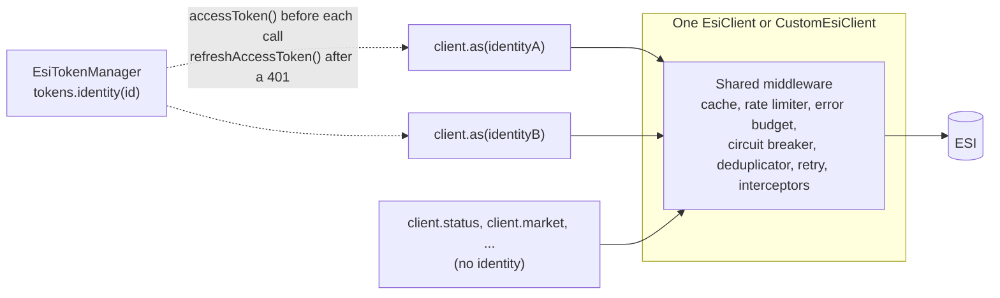

# Many characters, one runtime

**Implements:** `ARCH-08` · `SEC-02` · `DES-01`. See [CHARTER.md](CHARTER.md) Part 2 and Part 6. **Specification:** `tests/bdd/features/core/0056-shared-runtime.feature`, `tests/bdd/features/core/0063-custom-client-identity-views.feature`.

An application that acts for more than one character (a corporation tool, a market bot, an alliance auth service) has one relationship with ESI, not one per character. ESI meters every request by the calling IP, and the error budget that a 420 exhausts is the application's, not a character's. So ESI.ts builds one pipeline and hands out a view of it for each identity.

With the custom clients, the product (see [CLIENT-ARCHITECTURE.md](CLIENT-ARCHITECTURE.md)), that is `as(identity)` on an `EsiClient` or a `CustomEsiClient`:

```ts
import { EsiClient } from '@lgriffin/esi.ts';

const client = new EsiClient({ clientId: 'fleet-tool/2.1 (ops@example.com)' });

const status = await client.status.getStatus();
const pilot = client.as(tokens.identity(characterId));
const balance = await pilot.wallet.getCharacterWallet(characterId);
```



`client.as(identity)` returns the same domain clients, sending as that identity. Every view shares the client's cache, rate limiter, circuit breaker, deduplicator, retry policy, interceptors and settings, and the cache keeps each character's authenticated entries apart. The view asks `identity.accessToken()` before each authenticated request and `identity.refreshAccessToken()` after a 401, the same identity returns the same view, and a view cannot change its identity (`setAccessToken` and `setTokenProvider` throw on it). `Identity`, `identityFromToken` and `identityFromProvider` are exported from the root entry as well as `./client`. Specification: `tests/bdd/features/core/0063-custom-client-identity-views.feature`.

The spec-shaped surface, `createEsi()` from `@lgriffin/esi.ts/client`, has had the same model from the start, and the custom clients' views run on the same code:

```ts
import { createEsi } from '@lgriffin/esi.ts/client';

const esi = createEsi({ userAgent: 'fleet-tool/2.1 (ops@example.com)' });

const status = await esi.public.status.get();
const wallet = await esi
  .as(tokens.identity(characterId))
  .character(characterId)
  .wallet.get();
```

Most of what follows holds for both surfaces, because the views are built by the same code. The sections below walk through the `createEsi` runtime, since it is the one with options of its own, then how to move over from `EsiTokenManager.createClient`.

## The runtime

`createEsi(options)` builds one request pipeline: rate limiter, error budget, circuit breaker (when enabled), in-flight deduplicator, ETag cache and transport. Every view hands its requests to that one pipeline. The options are the pipeline options `EsiClient` takes, with two differences:

- **`userAgent` is required.** CCP asks every caller to identify itself, so a misbehaving application can be contacted rather than blocked. `EsiClient` leaves it optional for compatibility; `createEsi` refuses to construct without one, at construction rather than on every request, and refuses a value that is not a legal header value for the same reason (`0055-request-headers.feature`).
- **There is no token option.** Tokens belong to identities, below. The runtime itself never holds one.

```ts
import { createEsi } from '@lgriffin/esi.ts/client';

const esi = createEsi({
  userAgent: 'fleet-tool/2.1 (ops@example.com)',
  tenant: 'singularity',
  enableCircuitBreaker: true,
  retryConfig: { maxRetries: 3, baseDelayMs: 1000, maxDelayMs: 30_000 },
  logLevel: 'info',
});
```

The runtime is frozen: it has no setters, so nothing about it changes after construction. Build a second runtime for a second tenant or a second application identity.

## The public view

`esi.public` reaches every operation that needs no SSO scope, arranged by resource:

```ts
const status = await esi.public.status.get();
const alliance = await esi.public.alliance(99000001).get();
for await (const order of esi.public
  .market(regionId)
  .orders.get({ order_type: 'sell' })) {
  // one order at a time, every page followed
}
```

Its type is `PublicScopeTree`, generated from the ESI OpenAPI document with the authenticated operations left out. A call that needs a scope does not compile:

```ts
// @ts-expect-error the wallet needs esi-wallet.read_character_wallet.v1
esi.public.character(characterId).wallet.get();
```

That is the answer to [#183](https://github.com/lgriffin/ESI.ts/issues/183): the split between public and authenticated is a type, so a missing token is a compile error, not a 401 in production. The runtime guards the same line for a caller who casts past the type: an authenticated operation forced through the public view is rejected with `NO_AUTH_TOKEN` before any request is sent.

The public view sends no `Authorization` header, whatever tokens the runtime's other views hold. A public request is never attributed to a character.

Two operations are not in ESI's specification and come from `scripts/spec/operation-overlay.json` instead: `esi.public.meta.openapiJson.get()` resolves with the parsed specification document and `esi.public.meta.openapiYaml.get()` with the YAML text, unparsed, asked for with `Accept: application/yaml, text/yaml, text/plain`, as `MetaClient.getOpenApiJson()` and `getOpenApiYaml()` on the custom clients do.

When an operation the spec marks deprecated is called, through any view, the runtime logs one warning through its logger per call (per iteration for a paginated one): `Operation '<operationId>' is deprecated.`, followed by the message, replacement and sunset date when `scripts/spec/operation-overlay.json` records them. The same guidance is on `OperationMeta.deprecation` and in the operation's `@deprecated` JSDoc. The custom clients log the same warning, worded by the same helper, as `Endpoint '<method>' is deprecated.` from the endpoint definition's `DeprecationInfo`. No operation is deprecated in the current specification.

## Identities and `as()`

`esi.as(identity)` returns a view over the same runtime that sends as one identity. Its type is `ScopeTree`, the full tree, so every operation is there. The view is immutable: it holds the identity it was built with, and the same `Identity` object gets the same view back, so `esi.as(identity)` in a request handler costs nothing after the first call.

An identity is anything with these members:

```ts
interface Identity {
  readonly characterId?: number;
  accessToken(): Promise<string>;
  refreshAccessToken?(): Promise<string>;
}
```

Before each authenticated request the view calls `accessToken()`, so a holder that knows its token is about to expire can refresh first. When ESI answers 401, the view calls `refreshAccessToken()` and retries once; an identity without it cannot refresh, and the 401 is the caller's answer after a single request.

Three ways to get one:

**From `EsiTokenManager`.** The manager holds one refresh token per character and keeps the access token fresh. `tokens.identity(characterId)` hands out the stored token, refreshing it first when it is inside the refresh skew, and refreshes through SSO after a 401. Nothing is looked up until a request needs it, so an unknown character fails at the request, not when the identity is made.

```ts
const view = esi.as(tokens.identity(characterId));
const balance = await view.character(characterId).wallet.get();
```

**From a raw access token.** For a script that was handed a token, or a token another system keeps fresh:

```ts
import { identityFromToken } from '@lgriffin/esi.ts/client';

const view = esi.as(identityFromToken(token));
```

It cannot refresh. When the token expires, calls fail with a 401 and the caller makes a new identity.

**From a `TokenProvider`.** The same function the legacy `onTokenRefresh` option takes: it returns the current token, refreshing first when it knows the old one has expired. The view asks it before each request, before each page of a paginated operation, and again after a 401.

```ts
import { identityFromProvider } from '@lgriffin/esi.ts/client';

const view = esi.as(identityFromProvider(myRefreshFunction, { characterId }));
```

`characterId` on an identity is for diagnostics: the cache keys itself by the character the token names, not by this field.

## What the views share

Everything but the token. One request through any view moves the same rate-limit window, spends the same error budget, and counts against the same circuit. An endpoint that opens its circuit through one character's view is rejected, without a request, through the public view and every other view until the reset timeout passes.

The ETag cache is shared too, in two ways:

- **Public entries are shared across views.** The server status fetched through one character's view is served to the public view, and to every other view, from the cache for as long as the spec TTL says it is fresh.
- **Authenticated entries are kept apart by identity.** Two characters in one corporation ask the same corporation wallet URL and get answers scoped to their own roles, so each identity has its own entry. The key carries the character the token names, read from the SSO token's `sub` claim, so a token refresh keeps the character's entries and its ETags: the first request under the new token is a conditional request answered by a 304, not a full download. A token that names no character is keyed by a hash of the token instead. The token itself never appears in a key ([SECURITY.md](SECURITY.md), Cache isolation).

The in-flight deduplicator draws the same line: identical public GETs from two views share one request; identical authenticated GETs share one only when they are for the same character.

When an application is done with a runtime, `esi.shutdown()` stops the cache's and circuit breaker's cleanup timers and drops the in-flight table, once for the runtime rather than once per view. The timers never keep a process alive on their own, so a script that forgets it still exits; the call is for an application that replaces a runtime and wants nothing of the old one left running. Calling it twice is harmless, and a view still answers afterwards.

### Metadata, safe mode, diagnostics and your own middleware

`esi.withMetadata()` and `esi.withSafeMode()` return the same `public` and `as(identity)` views over the same clients, resolving `{ data, meta }` or `{ ok, data | error }` instead of the bare body (paginated operations still yield items). `esi.diagnostics`, and the shortcuts `getCacheStats()`, `clearCache()`, `updateCacheConfig()`, `getCircuitBreakerStats()` and `resetCircuitBreaker()`, answer for the whole runtime.

`EsiOptions` takes instances as well as configuration: `cache` (a `CacheStore`, such as a Redis-backed store, or an `ICache`), `rateLimiter`, `circuitBreaker` (which turns the breaker on), `deduplicator` (which turns deduplication on) and `clock` (the `Clock` port: cache age, retry back-off, rate-limit waits and the circuit reset timeout read it; the cleanup timers and request timeout stay on real time). `shutdown()` leaves a supplied cache, circuit breaker or deduplicator to its owner. A plain `CacheStore` cannot list its keys, so after a write the runtime invalidates only the entries written in this process. The custom clients take the same five options in `EsiClientConfig` and have the same diagnostics and views ([USAGE.md](USAGE.md#supplying-your-own-middleware)), so an `EsiClient` and a runtime given one `cache`, `rateLimiter` and `circuitBreaker` share them.

## Revoked tokens, scheduled refresh and concurrency

With a token manager, a character whose refresh token SSO has revoked throws `TokenRevokedError` from `accessToken()`, so the call fails before any request. Catch it with `isTokenRevoked` from `@lgriffin/esi.ts/errors`, remove the character and send them through login again.

`tokens.refreshAll()` on a schedule keeps every stored token fresh so that no request has to wait on SSO. It is unchanged by the runtime; a view picks up the refreshed token at its next request, because it asks the identity each time.

Concurrent requests through one view are safe. A refresh coalesces: two requests that hit 401 at the same time cause one SSO call, and both retry with its result. Concurrent requests through views for different characters are independent, apart from the shared budgets above.

## Testing a view

A test hands the runtime a mock transport instead of the network: `createMockTransport()` from `@lgriffin/esi.ts/testing` answers requests from a table of routes and records what each view sent, so a test can assert which token went out and which requests were made. The README's [quick start](../README.md#testing-your-application-without-esi) runs one; [TESTING.md](TESTING.md#testing-your-application) has the route options.

## Moving from `EsiTokenManager.createClient`

`tokens.createClient(id)` builds a complete `EsiClient` per character, each with its own rate limiter, error budget and cache. It still works and behaves as before, but 11.0.0 marks it `@deprecated`, as it does `EsiApiFactory`'s nine named `create*Client` methods (use `EsiApiFactory.createClient(type)` or `EsiClientBuilder` for those). Removing them needs a future major release, and none is scheduled. The rest of the custom clients are supported and stay the product ([CLIENT-ARCHITECTURE.md](CLIENT-ARCHITECTURE.md)).

The shortest move keeps the custom clients and their method names, and builds one client with a view per character:

| Before                                                        | After                                                          |
| ------------------------------------------------------------- | -------------------------------------------------------------- |
| `const client = await tokens.createClient(id, { userAgent })` | `const client = new EsiClient({ userAgent })`, once            |
| `client.wallet.getCharacterWallet(id)`                        | `client.as(tokens.identity(id)).wallet.getCharacterWallet(id)` |
| `client.status.getStatus()`                                   | `client.status.getStatus()`                                    |
| `client.market.streamMarketOrders(regionId)`                  | `client.market.streamMarketOrders(regionId)`                   |
| `client.shutdown()` per character                             | `client.shutdown()`, once                                      |

A view is an `EsiClient`, so `withMetadata()`, `withSafeMode()` and `diagnostics` work on it. The shared cache and circuit breaker belong to the client the view came from, so call `shutdown()` on that client; a view's `shutdown()` leaves them running.

To move to the spec-shaped surface instead:

| Before                                                        | After                                                             |
| ------------------------------------------------------------- | ----------------------------------------------------------------- |
| `const client = await tokens.createClient(id, { userAgent })` | `const esi = createEsi({ userAgent })`, once                      |
| `client.wallet.getCharacterWallet(id)`                        | `esi.as(tokens.identity(id)).character(id).wallet.get()`          |
| `client.status.getStatus()`                                   | `esi.public.status.get()`                                         |
| `client.market.streamMarketOrders(regionId)`                  | `for await (const o of esi.public.market(regionId).orders.get())` |
| `client.shutdown()` per character                             | `esi.shutdown()`, once                                            |

Its operations are the generated ones. They follow the ESI OpenAPI document exactly: resource-shaped names (`character(id).wallet.get()` rather than `wallet.getCharacterWallet(id)`), spec-typed responses, and every paginated operation returned as an `AsyncIterable` that follows the pages. They are validated against the generated schemas only when `createEsi` is given `validateResponse: true`.

`examples/multi-character.ts` reads several characters' wallets through one `EsiClient` with `client.as(identity)`, and `examples/public-vs-authenticated.ts` shows the type split with `buildPublic()` and its `@ts-expect-error` line, then the same calls through `createEsi()`.
